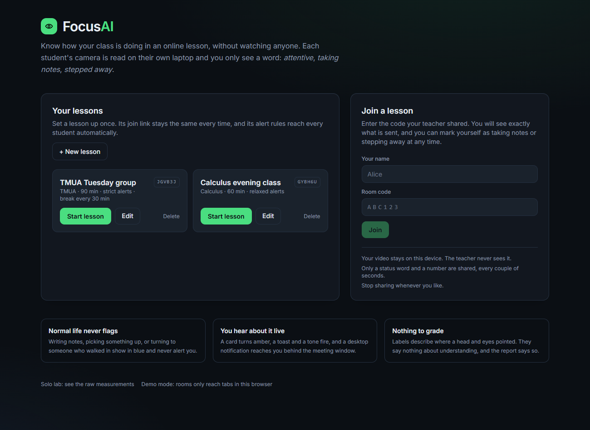
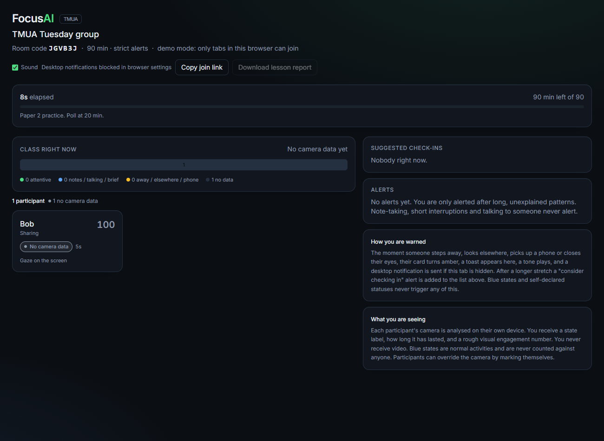
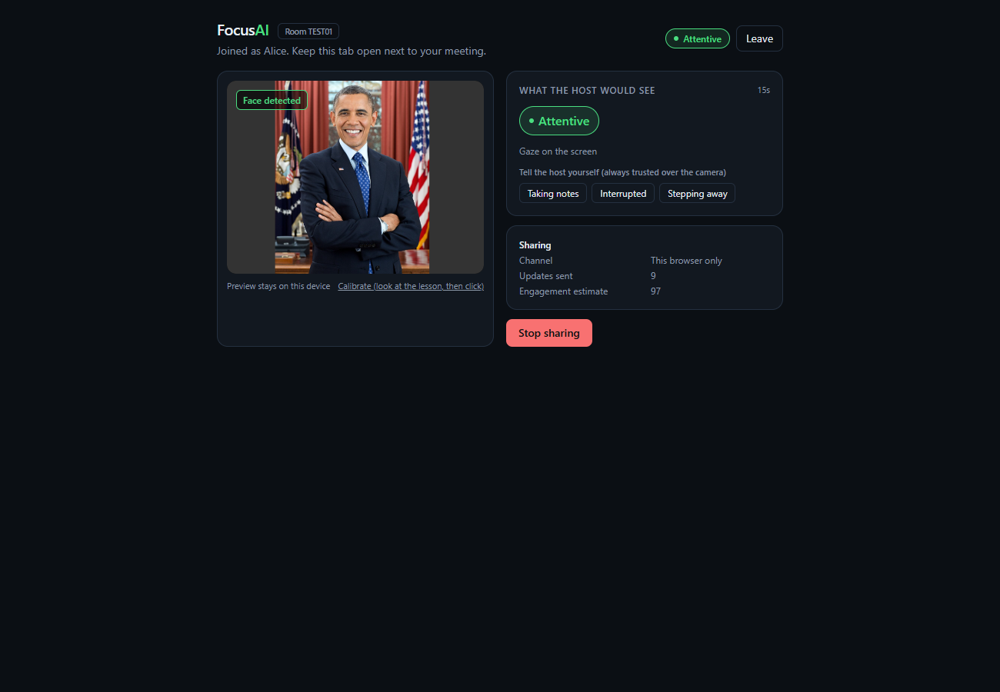
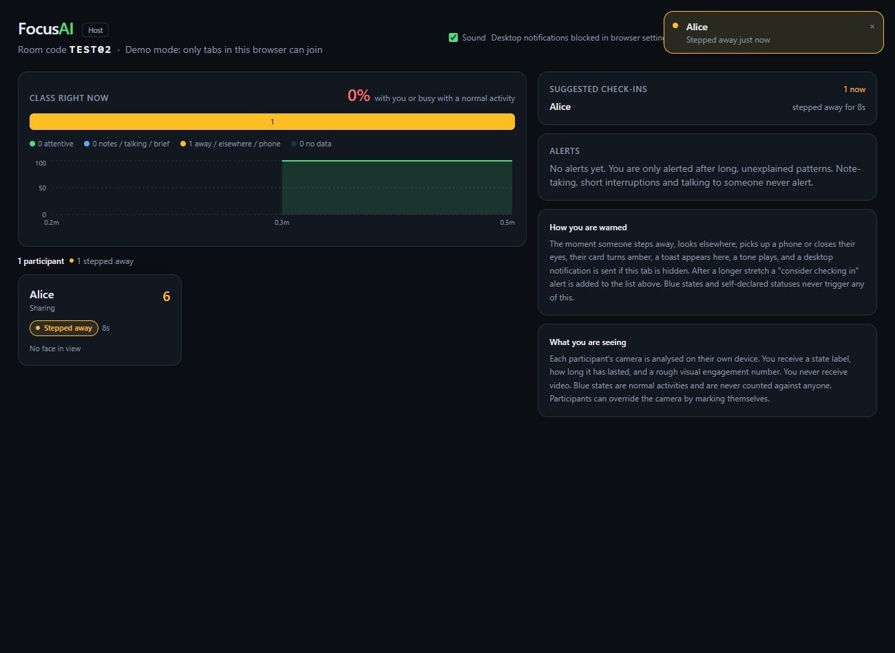
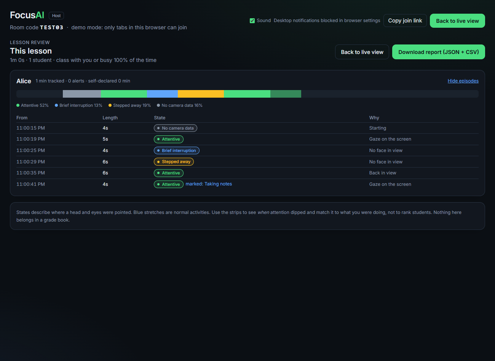

# FocusAI

**Live: https://focusai-self.vercel.app** · MIT licence · [Security](SECURITY.md)

FocusAI tells a teacher or meeting host how their class is doing in an online lesson,
without anyone watching the students. Each student opens FocusAI beside Zoom, Google Meet
or Teams. Their webcam is read **on their own laptop** and the host sees only a word:
*attentive*, *taking notes*, *stepped away*. When a pattern is long and unexplained the host
is nudged to check in. Video never leaves the student's computer.



## What it does

| For the teacher | For the student |
| --- | --- |
| Set a lesson up once (name, subject, duration, alert strictness, break reminders). It keeps a permanent room code, so the join link is the same every week. | Open the link, read a plain consent screen, click **I agree**. |
| See the whole class at a glance: a bar and percentage of who is with you, and a minute-by-minute chart of the lesson. | See exactly what the teacher sees about you, live, on your own screen. |
| Get warned **live**: the card turns amber, a toast and a tone fire, and a desktop notification reaches you behind the meeting window. | Press **Taking notes**, **Interrupted** or **Stepping away** and nothing flags. Your word beats the camera. |
| A "attention has sagged" box suggests a question, poll or break when the class drifts. | Stop sharing whenever you like. |
| After the lesson, review every student: a colour strip of their lesson, time in each state, every episode, and download JSON + CSV. | Nothing is stored about you on any server. |





## Normal life is not disengagement

The behaviour layer (`src/engagement/behavior.ts`) separates ordinary situations from real
disengagement and gives every state a generous benefit of the doubt:

| Situation | State | Alerts the host? |
| --- | --- | --- |
| Head down writing notes, glancing back now and then | Taking notes | No. One gentle info only after 4 min with no glance at all |
| Leaned out of view for under 5 s (dropped a pen) | Brief interruption | No |
| Turned to talk to someone who walked in, or a second face in view | Talking to someone | No. One info after 5 min |
| Student pressed "Taking notes", "Interrupted" or "Stepping away" | Their choice | No. Always trusted over the camera |
| Out of view for more than 5 s, not declared | Stepped away | Card turns amber and the host gets a toast, tone and desktop notification at once. "Consider checking in" after 3 min |
| Phone in hand with eyes off the screen (object detector), or head down with the face lit from below like a screen | Using phone | Immediate notice; check-in after 1 min |
| Looking elsewhere continuously, head up, not talking | Looking elsewhere | Check-in after 2 min |
| Eyes closed continuously | Eyes closed | Check-in after 45 s |

A new state must hold 3 s before it replaces the old one, so a glance never flips anything.
Each alert fires once per episode with a 5 minute cooldown. Lesson presets scale all of these
thresholds (Relaxed / Standard / Strict). `src/engagement/behavior.test.ts` simulates every
scenario above.



## After the lesson



**End lesson & review** shows one row per student: a colour strip of the whole lesson, their
share of time in each state, their alerts, and an expandable table of every episode (start,
length, state, self-declared status, reason). **Download report** gives a JSON with everything,
a summary CSV (one row per student) and an episodes CSV (one row per episode).

The percentages describe where a head and eyes were pointed. They say nothing about
understanding and must not be used for grading. The report says so in its own footer.

## Why it works this way

Meeting platforms do not let apps read participant video. Zoom permanently removed its own
attention tracker in April 2020, and neither the Zoom Apps SDK nor the Meet add-ons SDK gives
an app the camera. The only alternatives record everyone's video on a server, which is exactly
what FocusAI refuses to do. So it runs in the student's own browser and shares a label.
[docs/INTEGRATIONS.md](docs/INTEGRATIONS.md) covers embedding it as a Zoom App, Meet add-on,
Teams app or Chrome extension, and the consent checklist for a pilot.
[docs/TEACHER_GUIDE.md](docs/TEACHER_GUIDE.md) is the guide for teachers: what to do before,
during and after a lesson, with a consent script and good responses per state.

## Privacy, in one table

What crosses the network from a student, every 2 seconds:

| Field | Example |
| --- | --- |
| state | `taking_notes` |
| since | timestamp |
| score | 71 (visual engagement 0–100) or null |
| selfStatus | `notes` if the student marked themself |
| reason | "Head down, facing the desk" |

Never: frames, images, landmarks, raw angles, audio. Messages are relayed through Supabase
Realtime and are not stored. Lesson presets live in the teacher's browser.

## Run it yourself

```bash
npm install
npm run dev        # http://localhost:5173
npm test           # 16 scenario tests
npm run build      # static site in dist/
```

Routes:

| Route | Who | What |
| --- | --- | --- |
| `#/` | everyone | Set up or start a lesson; join one with a code |
| `#/host/CODE?preset=ID` | teacher / host | Live roster, class overview, check-ins, alerts, review |
| `#/join/CODE?name=Alice` | student | Consent screen, local camera analysis, self-status buttons |
| `#/lab` | developers | Raw measurements, score components, tuning |

Rooms use Supabase Realtime when `VITE_SUPABASE_URL` and `VITE_SUPABASE_ANON_KEY` are set
(see `.env.example`). Without them the app runs in demo mode where only tabs in the same
browser see each other. Deploy the `dist/` folder anywhere static; `vercel.json` sets the
cache and camera headers. The site must be served over HTTPS for camera access.

## How it measures

- MediaPipe Face Landmarker (478 landmarks, blendshapes, head transform) in WebAssembly.
- Head pose (yaw / pitch / roll), eye direction, presence, jaw movement, head stability.
- MediaPipe EfficientDet Lite0 object detector, restricted to the "cell phone" class, sampled
  a few times per second and smoothed over about 2 s.
- A lighting probe comparing the chin with the forehead against a learned baseline, to catch a
  screen glowing from below.
- A rolling 10 s window gives the 0–100 visual engagement estimate
  `E = 0.30·G + 0.25·H + 0.20·P + 0.15·S + 0.10·M` and shows **Insufficient data** when the
  face cannot be measured reliably.
- The behaviour layer reasons over minutes on top of that window, and keeps running when the
  tab is hidden behind the meeting.

## Layout

| Path | Purpose |
| --- | --- |
| `src/vision/` | MediaPipe wrappers (face, phone), head pose, eye and mouth estimates, lighting probe |
| `src/engagement/engagement.ts` | Rolling-window components and score |
| `src/engagement/behavior.ts` | States, benefit-of-the-doubt timing, self-status, alerts |
| `src/lessons/presets.ts` | Lesson presets with permanent room codes and alert sensitivity |
| `src/room/` | Room protocol, transports (Supabase Realtime, BroadcastChannel), host notifications, per-student episode log |
| `src/hooks/useSession.ts` | Camera lifecycle and analysis loop |
| `src/pages/` | Home, Host, Join, Lab |
| `src/components/` | Class overview, lesson review, behaviour panel, webcam view, gauge, charts |
| `docs/` | Integration guide, teacher guide, screenshots |

## Licence

MIT, see [LICENSE](LICENSE). Copyright (c) 2026 Ali Hasanli.
